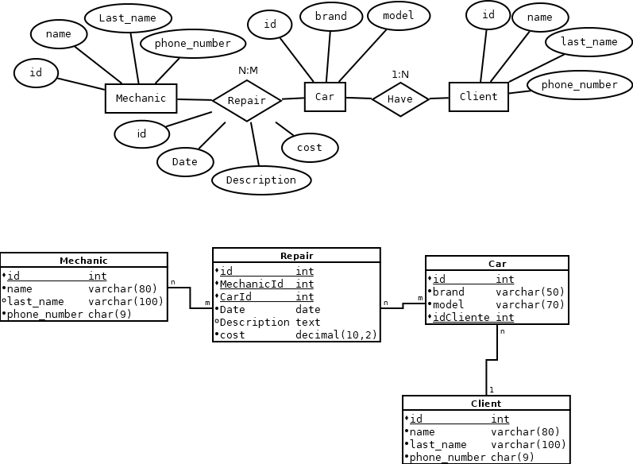

## Workshop Management Service

My initial idea is to build a fully functional, console-based application—drawing on my knowledge of databases and how to handle them using Java—that would allow a repair shop to manage its database much more easily. 

The person using the application will be able to easily add mechanics, customers, and appointments, as well as search for any type of information in the database.

## Phase 1: DataBase design

## Final Work

I've finally reached the end. I managed to create a basic console application to interact with the database allowing the user to interact with the database without needing to write SQL queries directly.

## Technologies Used

Basically, I used Java for the methods and SQL for the queries.

## What I have learned

This project served as a great practical review to solidify my knowledge of JDBC, ,DAO architecture, and handling relational data in Java. it was mostly a refresher on using methods to call SQL, creating menus, and handling specific tasks like converting a String to a date so, overall, a review of Java and SQL syntax.

## Areas for improvement

If I had had more time, I would have liked to display all the objects first for queries requiring an ID, but I set a time limit for myself to finish the project.

Another thing that could have been improved was adding more queries and looking at it from the outside, perhaps replacing some queries with more useful ones.
